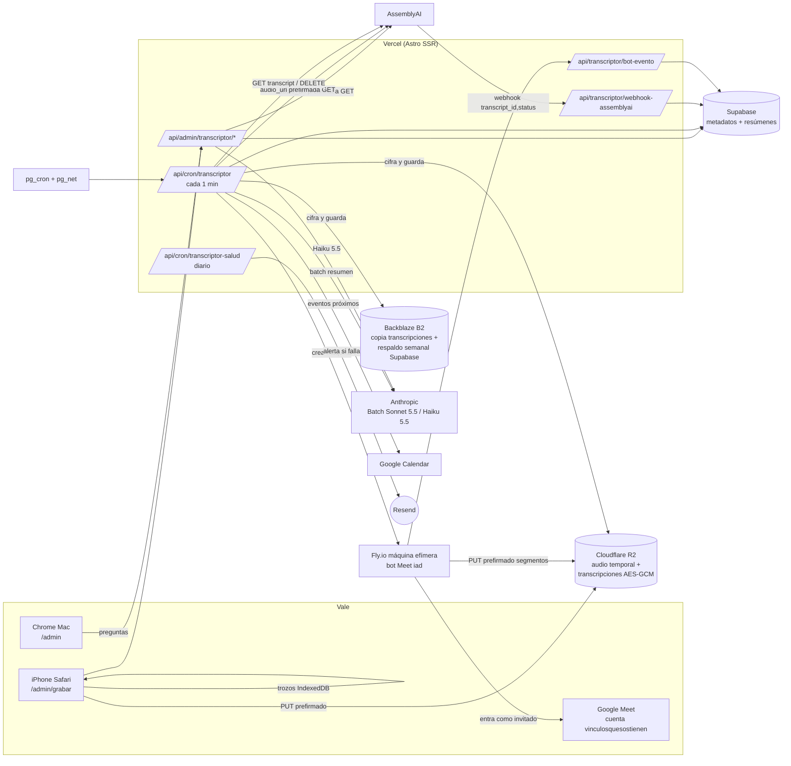
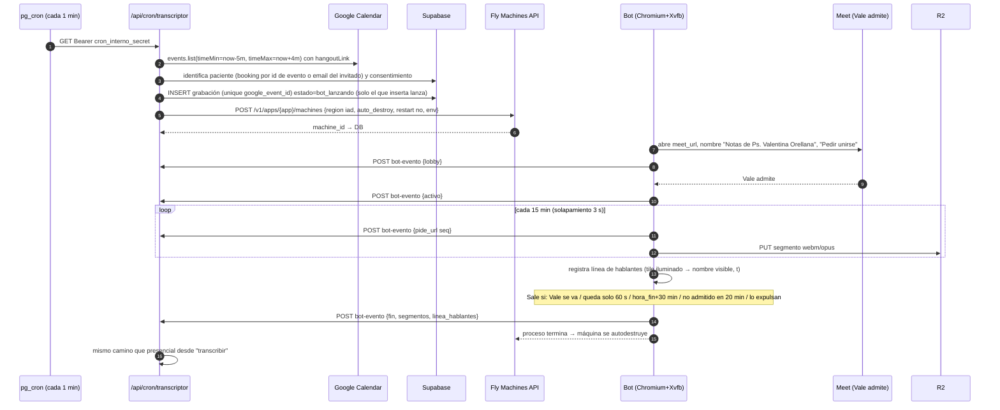
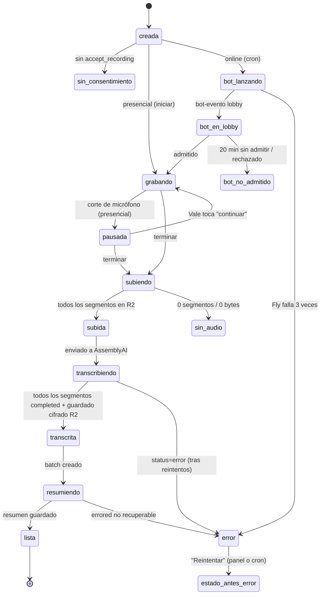

# Transcriptor IA — Arquitectura (v1, 15 oct 2026)

Autor: arquitecto/a líder. Base: `00-decisiones.md` (no se re-discute) + exploración del repo `vo-fix-1-4` + documentación oficial citada en §9.
Todo lo marcado **[VERIFICAR]** es un detalle que la documentación oficial no confirma explícitamente y que el paquete responsable debe probar antes de darlo por hecho.

---

## 0. Lo que el repo ya tiene y que este diseño reutiliza (verificado en el código)

| Tema | Cómo está hecho hoy | Archivo |
|---|---|---|
| Auth del panel | Cookie `vo_admin_token` = token HMAC `v1.<vence>.<firma>` (8 h) + lista de revocados en `settings`. El middleware protege `/admin/*` y `/api/admin/*` (salvo `/api/admin/login`), exige mismo origen en POST de `/api/admin/*` y pone `Cache-Control: private, no-store`. | `src/middleware.ts`, `src/lib/adminSession.ts` |
| Supabase | Un solo cliente `service_role` (`src/lib/supabase.ts`). Todas las tablas con RLS activado **sin políticas**; cada migración agrega `grant select, insert, update, delete … to service_role` (y `grant usage, select on sequence` para bigserial). Migraciones = SQL que se pega a mano en el SQL Editor. | `supabase/migrations/0004…0012` |
| Pacientes | `patients` (id uuid, name, email, phone, rut, active, …). **No hay `patient_id` en `bookings`**: la relación es por `bookings.patient_email = patients.email` (ver `admin/pacientes/[id].astro`). | `src/lib/patients.ts` |
| Sesiones | `bookings.session_type ∈ {'online','presencial','pareja-online','pareja-presencial'}` → tipo = `pareja` si empieza con `pareja`, modalidad = `online` si contiene `online`. Además `session_date`, `session_time`, `duration_min`, `status` (`pending_payment`/`confirmed`/`cancelled`/`expired`), `paid_at`, `google_event_id`. | `src/lib/syncCalendar.ts` |
| Enlace Meet | **No hay columna**: se guarda como línea `Meet: <url>` dentro de `bookings.notes` (`syncCalendar.ts:214`). El id del evento de Google es determinístico = `booking.id` sin guiones. Encuadrado crea sus propios eventos en el mismo calendario (duplicados intencionales). | `src/lib/syncCalendar.ts`, `src/lib/googleCalendar.ts` |
| Notas clínicas | `session_notes` (patient_id, booking_id, session_date, session_type, content, deleted_at, historial). Nunca se borran (15 años). | `0007_notas_sin_borrado.sql` |
| Consentimiento | `consents` con `accept_recording`; `vigente()` en `src/lib/consent.ts`. La ficha ya muestra "NO autoriza — no grabar". | `src/lib/consent.ts` |
| Alertas | Resend (`src/lib/email.ts`, remitente "Ps. Valentina Orellana", destino `settings.notification_email` o `ADMIN_EMAIL_FALLBACK`). Log en `admin_logs` (`src/lib/logger.ts`). Avisos en el panel vía `src/lib/saludSitio.ts` (patrón `Chequeo<T>` con `fallo.desde`). | |
| Crons | Vercel Hobby = solo diarios (`vercel.json`). La frecuencia real la da **Supabase pg_cron + pg_net cada 5 min** (job `tareas-cada-5-min`) llamando endpoints con `Bearer <settings.cron_interno_secret>`; `cronAutorizado()` acepta eso o `CRON_SECRET`. | `src/lib/cronAuth.ts`, `.github/workflows/frequent-cron.yml` |
| Envíos "una sola vez" | `tareas_envio` con `unique(booking_id, tarea)` + toma atómica por estado. Mismo patrón para nuestras transiciones. | `0009_tareas_envio.sql`, `src/lib/tareasEnvio.ts` |
| Límites | `astro.config.mjs` fija `maxDuration: 60` para todas las funciones. `Permissions-Policy: camera=(), microphone=(), …` en **todo** el sitio (`vercel.json`). | |

Nota: este directorio **no es un repositorio git** (el entorno lo reporta así); los paquetes deben trabajar en el worktree real.

---

## 1. Flujos

### 1.1 Vista general



### 1.2 Presencial (iPhone)

```mermaid
sequenceDiagram
  autonumber
  participant V as Vale (iPhone /admin/grabar)
  participant IDB as IndexedDB
  participant S as Vercel /api/admin/transcriptor
  participant DB as Supabase
  participant R2 as R2
  participant A as AssemblyAI
  participant C as cron 1 min
  participant N as Anthropic Batch
  V->>S: POST grabacion-iniciar {booking_id|patient_id, ruido?}
  S->>DB: valida consentimiento vigente (accept_recording)<br>calcula modelo con reglas.ts, inserta grabación (estado=grabando)
  S-->>V: {grabacion_id, modelo, aviso modo avión}
  loop cada 10 s
    V->>IDB: guarda trozo (MediaRecorder audio/mp4 AAC 64 kbps)
  end
  Note over V: Wake Lock activo. Si el micrófono se corta: aviso rojo "La grabación se pausó" → tocar = nuevo segmento (seq+1)
  V->>V: "Terminar" → arma 1 Blob por segmento
  Note over V: Si no hay red (modo avión), queda "Pendiente de subir" y se reintenta al volver la red o al reabrir la página
  V->>S: POST subida-url {grabacion_id, seq, mime, bytes}
  S-->>V: URL PUT prefirmada R2 (15 min, Content-Type fijo)
  V->>R2: PUT segmento
  V->>S: POST grabacion-finalizar {segmentos:[{seq, bytes, sha256}]}
  S->>R2: HEAD de cada segmento (tamaño coincide)
  S->>A: POST /v2/transcript (audio_url = GET prefirmado 6 h, speech_models, language_code es, webhook + header)
  S->>DB: estado=transcribiendo
  V->>IDB: borra trozos SOLO tras 200 de finalizar
  A-->>S: webhook {transcript_id, status}
  S->>DB: registra webhook (idempotente), 200 en < 10 s
  C->>A: GET /v2/transcript/{id}
  C->>R2: cifra AES-GCM y guarda transcripción; copia a B2
  C->>R2: DELETE audio; C->>A: DELETE /v2/transcript/{id}
  C->>N: messages.batches.create (resumen con instrucciones de Vale)
  C->>N: batches.retrieve → results → guarda resumen → batches.delete
  C->>DB: estado=lista (resumen visible en la ficha: "Resumen automático (IA)")
```

### 1.3 Online (bot de Meet)



Diferencias online vs presencial:
- **Sin diarización pagada** (decisión): se transcribe sin `speaker_labels` y cada palabra se asigna al hablante cuyo intervalo de "tile iluminado" la contiene (`hablantes.ts`). Palabras sin intervalo o con dos hablantes simultáneos → "Hablante no identificado".
- Pareja online usa `universal-3-5-pro` (regla fija) pero **sin** `speaker_labels`.
- Caso límite: pareja online conectada desde **un solo dispositivo** → Meet muestra un solo tile; ambos quedan con el mismo nombre. Se etiqueta "Pareja (mismo dispositivo)". No se paga diarización (decisión vigente); queda como punto abierto para Vale (§10).

---

## 2. Modelo de datos — `supabase/migrations/0013_transcriptor.sql`

Principios: nada clínico se borra (15 años); el **texto completo** de la transcripción NO vive en Supabase (vive cifrado en R2 + B2); el **resumen** sí vive en Supabase porque es parte de la ficha (igual que `session_notes`). Estados con `check`, transiciones atómicas por `update … where estado = <esperado>`.

```sql
-- 0013_transcriptor.sql — Transcriptor IA (15 oct 2026)
-- Ejecutar UNA VEZ en el SQL Editor de Supabase. Aditivo: no toca tablas existentes
-- salvo insertar ajustes nuevos en settings y (opcional, al final) un job de pg_cron.

-- ── 1. Grabaciones: una por sesión grabada (presencial u online) ─────────────
create table if not exists public.grabaciones (
  id                uuid primary key default gen_random_uuid(),
  patient_id        uuid references public.patients(id) on delete restrict,  -- null = "sin asignar" (Vale la asigna)
  booking_id        uuid references public.bookings(id) on delete set null,
  google_event_id   text,                                   -- evento de Calendar (online; también presencial si se conoce)
  consent_id        uuid references public.consents(id) on delete set null, -- consentimiento vigente al iniciar
  origen            text not null check (origen in ('presencial','online')),
  tipo              text not null default 'sin_tipo' check (tipo in ('individual','pareja','sin_tipo')),
  lugar_con_ruido   boolean not null default false,
  modelo            text not null check (modelo in ('universal-2','universal-3-5-pro')),
  diarizacion       boolean not null default false,          -- speaker_labels de AssemblyAI (solo pareja presencial)
  estado            text not null default 'creada' check (estado in (
                      'creada','sin_consentimiento',
                      'bot_lanzando','bot_en_lobby','bot_no_admitido',
                      'grabando','pausada','subiendo','subida',
                      'transcribiendo','transcrita','resumiendo','lista',
                      'sin_audio','cancelada','error')),
  estado_antes_error text,                                   -- para reintentar desde donde falló
  session_date      date not null,
  inicio_at         timestamptz,
  fin_at            timestamptz,
  hora_fin_prevista timestamptz,                             -- online: inicio + duration_min (corte duro bot = +30 min)
  duracion_seg      integer check (duracion_seg is null or duracion_seg >= 0),
  meet_url          text,
  bot_machine_id    text,
  bot_token_sha256  text,                                    -- hash del token de un solo uso del bot
  linea_hablantes   jsonb,                                   -- online: [{t_ms, nombre, on}] (Meet)
  mapa_hablantes    jsonb,                                   -- {"A":"Ps. Valentina","B":"Paciente 1",...} editable por Vale
  intentos          integer not null default 0,
  ultimo_error      text,
  tomada_en         timestamptz,                             -- toma atómica del cron (lease 10 min)
  audio_borrado_at  timestamptz,                             -- todos los segmentos borrados de R2 y de AssemblyAI
  creada_por        text not null default 'vale' check (creada_por in ('vale','bot','cron')),
  created_at        timestamptz not null default now(),
  updated_at        timestamptz not null default now()
);
create unique index if not exists grabaciones_evento_unq
  on public.grabaciones (google_event_id) where google_event_id is not null and origen = 'online';
create index if not exists grabaciones_patient_idx on public.grabaciones (patient_id, session_date desc);
create index if not exists grabaciones_pendientes_idx on public.grabaciones (estado, updated_at)
  where estado not in ('lista','sin_audio','cancelada','sin_consentimiento','bot_no_admitido');
create index if not exists grabaciones_booking_idx on public.grabaciones (booking_id);

-- ── 2. Segmentos de audio (cada pausa/reanudación o cada 15 min del bot) ────
create table if not exists public.grabacion_segmentos (
  id                 uuid primary key default gen_random_uuid(),
  grabacion_id       uuid not null references public.grabaciones(id) on delete cascade,
  seq                integer not null check (seq >= 0),
  r2_key             text not null,                          -- audio/<grabacion_id>/<seq>.<ext>
  mime               text not null,
  bytes              bigint,
  sha256             text,
  offset_ms          integer not null default 0,             -- posición del segmento en la sesión
  duracion_ms        integer,
  subido_at          timestamptz,
  aai_transcript_id  text unique,
  aai_estado         text check (aai_estado in ('enviado','queued','processing','completed','error')),
  aai_enviado_at     timestamptz,
  aai_completado_at  timestamptz,
  aai_error          text,
  aai_audio_seg      numeric,                                -- audio_duration facturado (para costos)
  aai_borrado_at     timestamptz,                            -- DELETE /v2/transcript/{id} OK
  audio_borrado_at   timestamptz,                            -- DELETE del objeto en R2 OK
  created_at         timestamptz not null default now(),
  unique (grabacion_id, seq)
);
create index if not exists segmentos_aai_pend_idx on public.grabacion_segmentos (aai_estado)
  where aai_estado in ('enviado','queued','processing','completed');

-- ── 3. Transcripciones (solo punteros + metadatos; el texto está cifrado afuera)
create table if not exists public.transcripciones (
  id              uuid primary key default gen_random_uuid(),
  grabacion_id    uuid not null unique references public.grabaciones(id) on delete restrict,
  r2_key          text not null,                             -- transcripciones/<aaaa>/<mm>/<grabacion_id>.v1.enc
  b2_key          text,                                      -- misma ruta en B2 (null hasta copiar)
  b2_copiada_at   timestamptz,
  clave_version   smallint not null default 1,               -- TRANSCRIPTOR_CLAVE_V<n>
  sha256_cifrado  text not null,                             -- integridad del objeto
  bytes           integer not null,
  palabras        integer not null default 0,
  tokens_aprox    integer,                                   -- para decidir cuántas sesiones caben en una pregunta
  modelo          text not null,
  idioma          text not null default 'es',
  created_at      timestamptz not null default now()
);

-- ── 4. Instrucciones de Vale para la IA (versionadas, nunca se borran) ───────
create table if not exists public.instrucciones_ia (
  id          uuid primary key default gen_random_uuid(),
  uso         text not null check (uso in ('resumen','preguntas')),
  texto       text not null check (length(texto) between 1 and 20000),
  activa      boolean not null default false,
  created_at  timestamptz not null default now()
);
create unique index if not exists instrucciones_activa_unq on public.instrucciones_ia (uso) where activa;

-- ── 5. Resúmenes automáticos (parte de la ficha: no se borran ni se pisan) ───
create table if not exists public.resumenes_ia (
  id               uuid primary key default gen_random_uuid(),
  grabacion_id     uuid not null references public.grabaciones(id) on delete restrict,
  patient_id       uuid references public.patients(id) on delete restrict,
  version          integer not null default 1,               -- regenerar = nueva versión
  instrucciones_id uuid references public.instrucciones_ia(id) on delete set null,
  modelo           text not null default 'claude-sonnet-5-5',
  estado           text not null default 'pendiente' check (estado in ('pendiente','en_batch','listo','error')),
  batch_id         text,
  custom_id        text unique,                              -- 'res_<id>_<intento>' (≤64, [A-Za-z0-9_-])
  intentos         integer not null default 0,
  ultimo_error     text,
  contenido        text,                                     -- se muestra con la etiqueta "Resumen automático (IA)"
  tokens_entrada   integer,
  tokens_salida    integer,
  costo_usd        numeric(10,5),
  oculto_at        timestamptz,                              -- Vale puede ocultarlo; nunca se borra
  created_at       timestamptz not null default now(),
  listo_at         timestamptz,
  unique (grabacion_id, version)
);
create index if not exists resumenes_batch_idx on public.resumenes_ia (estado, batch_id) where estado in ('pendiente','en_batch');
create index if not exists resumenes_patient_idx on public.resumenes_ia (patient_id, created_at desc);

-- ── 6. Preguntas a la IA (Q&A con Haiku 5.5) ────────────────────────────────
create table if not exists public.preguntas_ia (
  id              uuid primary key default gen_random_uuid(),
  patient_id      uuid references public.patients(id) on delete restrict,
  grabacion_ids   uuid[] not null,
  pregunta        text not null check (length(pregunta) between 1 and 4000),
  respuesta       text,
  modelo          text not null default 'claude-haiku-5-5',
  tokens_entrada  integer,
  tokens_salida   integer,
  tokens_cache    integer,
  costo_usd       numeric(10,5),
  error           text,
  created_at      timestamptz not null default now()
);
create index if not exists preguntas_patient_idx on public.preguntas_ia (patient_id, created_at desc);

-- ── 7. Webhooks recibidos (idempotencia) ─────────────────────────────────────
create table if not exists public.transcriptor_webhooks (
  id            bigserial primary key,
  proveedor     text not null check (proveedor in ('assemblyai','bot')),
  evento_id     text not null,                               -- assemblyai: '<transcript_id>:<status>'; bot: '<grabacion_id>:<tipo>:<seq>'
  payload       jsonb,
  recibido_at   timestamptz not null default now(),
  procesado_at  timestamptz,
  unique (proveedor, evento_id)
);

-- ── 8. Registro de auditoría (quién vio/hizo qué). Solo agrega. ─────────────
create table if not exists public.transcriptor_auditoria (
  id            bigserial primary key,
  at            timestamptz not null default now(),
  actor         text not null check (actor in ('vale','sistema','bot','assemblyai','anthropic','cron')),
  accion        text not null,  -- grabar_inicio, grabar_fin, ver_transcripcion, descargar, preguntar, asignar_paciente,
                                -- regenerar_resumen, borrar_audio, alerta, consentimiento_faltante, ...
  grabacion_id  uuid,
  patient_id    uuid,
  ip            text,
  user_agent    text,
  detalle       jsonb
);
create index if not exists auditoria_grab_idx on public.transcriptor_auditoria (grabacion_id, at);
create index if not exists auditoria_at_idx on public.transcriptor_auditoria (at desc);
-- Inmutable incluso para service_role (que se salta RLS pero no los triggers).
create or replace function public.transcriptor_auditoria_inmutable() returns trigger
language plpgsql as $$ begin raise exception 'transcriptor_auditoria es solo de inserción'; end $$;
drop trigger if exists auditoria_inmutable on public.transcriptor_auditoria;
create trigger auditoria_inmutable before update or delete on public.transcriptor_auditoria
  for each row execute function public.transcriptor_auditoria_inmutable();

-- ── 9. Estado de salud (un registro por chequeo) + reportes mensuales ───────
create table if not exists public.transcriptor_salud (
  chequeo         text primary key,     -- 'assemblyai','anthropic','r2','b2','fly','calendar','pg_cron','atascadas',
                                        -- 'cobertura_online','audio_borrado','copias_b2','respaldo_supabase','gasto','clave'
  ok              boolean not null,
  revisado_at     timestamptz not null default now(),
  ultimo_ok_at    timestamptz,
  fallo_desde     timestamptz,
  detalle         jsonb,
  alertado_at     timestamptz           -- freno: 1 correo por chequeo cada 24 h
);
create table if not exists public.transcriptor_reportes (
  mes           date primary key,       -- primer día del mes reportado
  generado_at   timestamptz not null default now(),
  datos         jsonb not null,         -- conteos, costos por proveedor, fallas, latencias
  revisado_por_claude_at timestamptz,
  notas_revision text
);

-- ── 10. Costos (vista; los montos se registran en cada fila) ────────────────
create or replace view public.transcriptor_costos_mes as
select date_trunc('month', g.created_at)::date as mes,
       count(*) filter (where g.estado = 'lista')                       as sesiones_listas,
       sum(s.aai_audio_seg) / 3600.0                                    as horas_audio,
       (select coalesce(sum(r.costo_usd),0) from public.resumenes_ia r
         where date_trunc('month', r.created_at) = date_trunc('month', g.created_at)) as usd_resumenes,
       (select coalesce(sum(p.costo_usd),0) from public.preguntas_ia p
         where date_trunc('month', p.created_at) = date_trunc('month', g.created_at)) as usd_preguntas
from public.grabaciones g
left join public.grabacion_segmentos s on s.grabacion_id = g.id
group by 1;

-- ── RLS + permisos (regla del proyecto: sin políticas anon) ─────────────────
alter table public.grabaciones            enable row level security;
alter table public.grabacion_segmentos    enable row level security;
alter table public.transcripciones        enable row level security;
alter table public.instrucciones_ia       enable row level security;
alter table public.resumenes_ia           enable row level security;
alter table public.preguntas_ia           enable row level security;
alter table public.transcriptor_webhooks  enable row level security;
alter table public.transcriptor_auditoria enable row level security;
alter table public.transcriptor_salud     enable row level security;
alter table public.transcriptor_reportes  enable row level security;

grant select, insert, update, delete on public.grabaciones            to service_role;
grant select, insert, update, delete on public.grabacion_segmentos    to service_role;
grant select, insert, update, delete on public.transcripciones        to service_role;
grant select, insert, update, delete on public.instrucciones_ia       to service_role;
grant select, insert, update, delete on public.resumenes_ia           to service_role;
grant select, insert, update, delete on public.preguntas_ia           to service_role;
grant select, insert, update, delete on public.transcriptor_webhooks  to service_role;
grant select, insert, update, delete on public.transcriptor_auditoria to service_role; -- el trigger impide update/delete
grant select, insert, update, delete on public.transcriptor_salud     to service_role;
grant select, insert, update, delete on public.transcriptor_reportes  to service_role;
grant usage, select on sequence public.transcriptor_webhooks_id_seq  to service_role;
grant usage, select on sequence public.transcriptor_auditoria_id_seq to service_role;
grant select on public.transcriptor_costos_mes to service_role;
revoke all on public.transcriptor_costos_mes from anon, authenticated;

-- updated_at automático en grabaciones
create or replace function public.grabaciones_touch() returns trigger language plpgsql as $$
begin new.updated_at := now(); return new; end $$;
drop trigger if exists grabaciones_touch on public.grabaciones;
create trigger grabaciones_touch before update on public.grabaciones
  for each row execute function public.grabaciones_touch();

-- ── Ajustes (interruptores). Todo parte APAGADO. ─────────────────────────────
insert into public.settings (key, value) values
  ('transcriptor_activo',      'false'),   -- botón Grabar + pipeline
  ('transcriptor_bot_activo',  'false'),   -- bot de Meet automático
  ('transcriptor_presupuesto_clp', '35000'),
  ('transcriptor_usd_clp',     '950')
on conflict (key) do nothing;

-- Instrucciones iniciales (Vale las edita en /admin/transcriptor)
insert into public.instrucciones_ia (uso, texto, activa)
select 'resumen', 'Resume la sesión en español de Chile con: 1) Puntos clave. 2) Tareas que la psicóloga dio. 3) Qué revisar la próxima sesión. No inventes nada que no esté en la transcripción.', true
where not exists (select 1 from public.instrucciones_ia where uso = 'resumen');
insert into public.instrucciones_ia (uso, texto, activa)
select 'preguntas', 'Responde solo con lo que está en las transcripciones entregadas, citando fecha de sesión. Si no está, dilo.', true
where not exists (select 1 from public.instrucciones_ia where uso = 'preguntas');

-- ── (Opcional, ejecutar aparte) Job pg_cron de 1 minuto ─────────────────────
-- Copiar EXACTAMENTE la forma del job existente 'tareas-cada-5-min'
-- (select jobname, schedule, command from cron.job;) cambiando la URL a
-- https://www.valentinaorellana.cl/api/cron/transcriptor y el horario a '* * * * *'.
-- [VERIFICAR] la firma de net.http_get contra ese job antes de ejecutar.
```

Nota legal/técnica: la **pareja firma ambos** el consentimiento (decisión) — eso lo resuelve el paquete de consentimiento v3 (fuera de este documento). El transcriptor solo consulta una función `puedeGrabar(patientId, tipo)` en `src/lib/transcriptor/consentimiento.ts` que hoy usa `vigente(consents).accept_recording` y, cuando exista v3, exigirá las dos firmas para `tipo='pareja'`.

---

## 3. Archivos a crear / modificar

Convención: todo el código nuevo de servidor en `src/lib/transcriptor/` (carpeta propia → los paquetes no chocan con libs existentes). Endpoints privados bajo `/api/admin/transcriptor/*` (protegidos por el middleware existente, sin cambios); endpoints llamados por terceros bajo `/api/transcriptor/*` (públicos, autenticados por secreto/HMAC propio).

### 3.1 Base (paquete P0)
| Archivo | Responsabilidad |
|---|---|
| `supabase/migrations/0013_transcriptor.sql` | §2. |
| `src/lib/transcriptor/tipos.ts` | Tipos compartidos (`Grabacion`, `Segmento`, `Estado`, `ResultadoTranscripcion`, `LineaHablante`), **firmas** de las funciones que cada paquete implementa (contrato), constantes (`BOT_NOMBRE = 'Notas de Ps. Valentina Orellana'`, prefijos de llaves R2). |
| `src/lib/transcriptor/reglas.ts` | Regla FIJA de modelo: `elegirModelo({tipo, origen, lugarConRuido})` → pareja ⇒ `universal-3-5-pro` + `speaker_labels` (solo presencial; online sin diarización); individual/sin tipo ⇒ `universal-2`; ruido ⇒ `universal-3-5-pro`. `tipoDesdeSessionType('pareja-online') → 'pareja'`. Sin IA. Con pruebas de tabla. |
| `src/lib/transcriptor/estados.ts` | `transicionar(id, de[], a, cambios)` = `update … where id=? and estado in (de) returning *` (0 filas ⇒ otro proceso ya lo hizo); `tomar(id)` con lease 10 min (`tomada_en`). |
| `src/lib/transcriptor/auditoria.ts` | `auditar(actor, accion, {grabacion_id, patient_id, request, detalle})`. |
| `src/env.d.ts` | Tipos de variables nuevas (abajo). |
| `package.json` | `@anthropic-ai/sdk` (^0.134.0), `@aws-sdk/client-s3` y `@aws-sdk/s3-request-presigner` (^3.1152.0). AssemblyAI y Fly por `fetch` (sin SDK). |
| `vercel.json` | (a) Cambiar la regla global a `"source": "/((?!admin/grabar).*)"` y agregar regla `"/admin/grabar"` con `Permissions-Policy: camera=(), microphone=(self), geolocation=(), interest-cohort=()` + los demás encabezados de seguridad. **[VERIFICAR]** en un deploy de vista previa con `curl -I` que `/admin/grabar` recibe `microphone=(self)` y que `/` y `/admin` siguen con `microphone=()` (la doc de Vercel no define precedencia entre reglas que coinciden; por eso se usa negative lookahead y no "la última gana"). (b) Agregar cron diario `{"path":"/api/cron/transcriptor-salud","schedule":"0 11 * * *"}` (≈ 8:00 Chile; Hobby ±59 min). |

Variables de entorno (las pega Vale en Vercel; nunca en el repo):
`ASSEMBLYAI_API_KEY`, `ASSEMBLYAI_WEBHOOK_SECRET`, `ANTHROPIC_API_KEY`, `R2_ACCOUNT_ID`, `R2_ACCESS_KEY_ID`, `R2_SECRET_ACCESS_KEY`, `R2_BUCKET`, `R2_JURISDICCION` (`us`), `B2_ENDPOINT`, `B2_REGION`, `B2_KEY_ID`, `B2_APP_KEY`, `B2_BUCKET`, `TRANSCRIPTOR_CLAVE_V1` (32 bytes base64), `FLY_API_TOKEN` (token de deploy de la app del bot), `FLY_APP`, `FLY_IMAGEN` (`registry.fly.io/<app>:<tag>`), `BOT_HMAC_SECRET`.

### 3.2 Almacenamiento y cifrado (P1)
| Archivo | Responsabilidad |
|---|---|
| `src/lib/transcriptor/almacenamiento.ts` | Clientes S3 para R2 (`endpoint https://<ACCOUNT_ID>.us.r2.cloudflarestorage.com`, `region: 'auto'`) y B2 (endpoint S3 de la cuenta). `urlSubida(key, contentType, 900s)`, `urlLectura(key, 6h)` (para AssemblyAI), `put/get/head/delete`, `copiarAB2(key)`. |
| `src/lib/transcriptor/cifrado.ts` | AES-256-GCM con `node:crypto`. Formato: `"VOT1" | versión(1B) | iv(12B) | ciphertext | tag(16B)`, AAD = `grabacion_id`. `cifrar(json, grabacionId)`, `descifrar(buf, grabacionId)`; rotación por `clave_version`. |
| Config (manual, documentado) | Bucket R2 con jurisdicción `us`; **CORS** para `https://www.valentinaorellana.cl` (PUT, `Content-Type`); **regla de ciclo de vida** que borra `audio/` a 1 día (red de seguridad si falla el borrado). Bucket B2 privado con SSE-B2. |

### 3.3 AssemblyAI (P2)
| Archivo | Responsabilidad |
|---|---|
| `src/lib/transcriptor/assemblyai.ts` | `enviar(segmento, modelo, diarizacion)` → `POST https://api.assemblyai.com/v2/transcript` con `audio_url`, `speech_models: [modelo]`, `language_code: 'es'`, `speaker_labels` (+ `speakers_expected: 3` en pareja presencial), `webhook_url`, `webhook_auth_header_name: 'X-VO-Webhook'`, `webhook_auth_header_value: ASSEMBLYAI_WEBHOOK_SECRET`. `obtener(id)`, `borrar(id)` (`DELETE /v2/transcript/{id}`). |
| `src/lib/transcriptor/hablantes.ts` | Une segmentos (offset_ms, deduplica palabras en el solapamiento de 3 s), asigna hablantes: presencial pareja = etiquetas A/B/C de AssemblyAI → `mapa_hablantes`; online = intervalos de `linea_hablantes`. Salida: `[{inicio_ms, fin_ms, hablante, texto}]`. Pruebas con fixtures. |
| `src/pages/api/transcriptor/webhook-assemblyai.ts` | Público. Verifica header en tiempo constante; inserta en `transcriptor_webhooks` (`on conflict do nothing`); marca `aai_estado`; responde 200 **sin** trabajo pesado (AssemblyAI exige 2xx en < 10 s; un 4xx detiene los reintentos → solo se devuelve 4xx con header inválido). |

### 3.4 Claude (P3)
| Archivo | Responsabilidad |
|---|---|
| `src/lib/transcriptor/claude.ts` | Cliente `@anthropic-ai/sdk`. `crearBatch(resumenes[])` → `client.messages.batches.create({requests:[{custom_id, params:{model:'claude-sonnet-5-5', max_tokens, system, messages}}]})`; `revisarBatch(id)` → `client.messages.batches.retrieve(id)` (`processing_status === 'ended'`); `leerResultados(id)` → `for await (const r of await client.messages.batches.results(id))` con `r.result.type ∈ succeeded/errored/canceled/expired`; `borrarBatch(id)` (`DELETE /v1/messages/batches/{id}`, solo tras terminar). `preguntar(...)` sincrónico con `claude-haiku-5-5`. |
| `src/lib/transcriptor/resumen.ts` | Arma el prompt: sistema fijo (español de Chile, no inventar, formato con 3 secciones, marca "Resumen automático (IA)") + instrucciones activas de Vale + transcripción con hablantes. Esfuerzo bajo / sin pensamiento extendido para controlar costo **[VERIFICAR]** con Models API (`capabilities.thinking.types.disabled`). |
| `src/pages/api/admin/transcriptor/preguntar.ts` | POST {patient_id, grabacion_ids[], pregunta}. Descifra transcripciones, limita a **≤ 95.000 tokens** (Haiku 5.5 cobra 5× más sobre 100k), si no caben usa resúmenes de las más antiguas; prompt caching del bloque de transcripciones (preguntas seguidas). Guarda en `preguntas_ia` + auditoría. |

### 3.5 Grabador presencial (P4)
| Archivo | Responsabilidad |
|---|---|
| `src/pages/admin/grabar.astro` | Página móvil (375 px primero). Elige sesión de hoy (bookings presenciales del día + "otra paciente"), muestra consentimiento OK/NO, botón **"Lugar con ruido"** (antes de empezar; queda bloqueado al iniciar), botón **Grabar**. Recordatorio: "Activa modo avión y apaga el Wi-Fi". `MediaRecorder` (`audio/mp4` en Safari, `audio/webm;codecs=opus` en Chrome; `audioBitsPerSecond: 64000`, `timeslice` 10 s) → IndexedDB. Wake Lock (`navigator.wakeLock.request('screen')`, se re-pide en `visibilitychange`). Detecta corte (`track.onended`/`mute`, `recorder.onerror`, `pagehide`) → aviso rojo grande **"La grabación se pausó"** + tocar para continuar (nuevo segmento). Subida al terminar o al volver la red (`online`), reintentos con backoff, borra IndexedDB solo tras 200 de `finalizar`. Lista "Pendientes de subir" si quedó algo. |
| `src/pages/api/admin/transcriptor/grabacion-iniciar.ts` | Valida `transcriptor_activo`, consentimiento (`puedeGrabar`), aplica `reglas.ts`, inserta `grabaciones` (estado `grabando`), auditoría. |
| `src/pages/api/admin/transcriptor/subida-url.ts` | Devuelve PUT prefirmado (15 min, `ContentType` fijado en la firma) para `audio/<id>/<seq>.<ext>`; crea/actualiza fila de segmento. |
| `src/pages/api/admin/transcriptor/grabacion-finalizar.ts` | HEAD de cada segmento en R2 (tamaño = declarado), estado `subida`, envía a AssemblyAI (o lo deja para el cron si falla), responde rápido. |
| `src/lib/transcriptor/consentimiento.ts` | `puedeGrabar(patientId, tipo)`. |

El audio **nunca** pasa por Vercel (límite de 4,5 MB por request): va directo iPhone → R2 con URL prefirmada.

### 3.6 Bot de Meet (P5)
| Archivo | Responsabilidad |
|---|---|
| `bot/` (carpeta nueva, fuera de `src/`) | Código del bot derivado de Vexa (ver §5): `bot/Dockerfile`, `bot/fly.toml`, `bot/package.json`, `bot/src/index.ts`, `bot/src/meet/*` (copiado de Vexa), `bot/LICENSE` (Apache-2.0) y `bot/NOTICE` con atribución y lista de cambios. |
| `src/lib/transcriptor/bot.ts` | `sesionesOnlineProximas(desde, hasta)` (Google Calendar del token ya conectado: `hangoutLink`/`conferenceData`; cruza con `bookings` por `google_event_id` = id del booking sin guiones, o con `patients.email` del invitado para eventos de Encuadrado; descarta cancelados/rechazados). `lanzarBot(grabacion)` → `POST https://api.machines.dev/v1/apps/{FLY_APP}/machines`. `matarBot(machineId)`. Token del bot = HMAC(`BOT_HMAC_SECRET`, grabacion_id + vence), se guarda solo su SHA-256. |
| `src/pages/api/transcriptor/bot-evento.ts` | Público con `Authorization: Bearer <token bot>`. Eventos: `lobby`, `activo`, `pide_url{seq}` (→ PUT prefirmado), `segmento_subido{seq,bytes,offset_ms,duracion_ms}`, `fin{motivo, linea_hablantes}`, `error{detalle}`. Idempotente vía `transcriptor_webhooks (proveedor='bot')`. |
| `infra/respaldo-supabase/` | Dockerfile mínimo (`postgres` client + `openssl`/`age`) que hace `pg_dump` cifrado → B2. Máquina Fly programada `--schedule weekly` (flyctl documenta `--schedule hourly|daily|weekly|monthly` y `--rm`). |

### 3.7 Orquestador (P6)
| Archivo | Responsabilidad |
|---|---|
| `src/pages/api/cron/transcriptor.ts` | Cada 1 min (pg_cron). `cronAutorizado()`. Presupuesto de 50 s (maxDuration 60). Pasos, cada uno acotado y con `tomar()`: (1) **despachar bots** (si `transcriptor_bot_activo`): eventos que empiezan en [ahora−5, ahora+4] min; (2) reintentar envíos a AssemblyAI pendientes; (3) segmentos `completed` (webhook) o `processing` > 30 min sin webhook (sondeo) → `obtener`, unir, cifrar, guardar R2, copiar B2, borrar audio R2 + `DELETE` en AssemblyAI; (4) crear **un** batch con todos los resúmenes `pendiente`; (5) revisar batches `en_batch` → guardar resultados → `borrarBatch`; (6) vigilancia: bots vivos después de `hora_fin_prevista + 45 min` → `matarBot`; grabaciones `tomadas` con lease vencido → liberar. Latido en `settings.transcriptor_latido`. |
| `src/lib/transcriptor/pipeline.ts` | Implementación de los pasos (testeable sin HTTP). |

### 3.8 Panel (P7)
| Archivo | Responsabilidad |
|---|---|
| `src/pages/admin/transcriptor.astro` | Estado de grabaciones (hoy / pendientes / con error, con botón "Reintentar"), "Sin asignar" (asignar paciente), editor de instrucciones (resumen / preguntas; guarda nueva versión), interruptores, gasto del mes vs $35.000, salud. |
| `src/pages/admin/pacientes/[id].astro` (modificar) | Nueva pestaña `tab=ia` "Sesiones grabadas (IA)": lista de grabaciones, resúmenes con etiqueta **"Resumen automático (IA)"**, botón "Ver transcripción", caja "Preguntar a la IA" (elige sesiones). En pestaña `notas`, los resúmenes aparecen intercalados por fecha y etiquetados (sin mezclarse con `session_notes`). |
| `src/pages/admin/pacientes/[id]/sesion/[gid].astro` | Transcripción descifrada en el servidor (nunca cacheada; ya hay `no-store`), hablantes renombrables (`mapa_hablantes`), auditoría `ver_transcripcion`. |
| `src/pages/api/admin/transcriptor/{asignar,reintentar,instrucciones,ajustes,regenerar-resumen,hablantes}.ts` | Acciones del panel. |
| `src/components/admin/AdminLayout.astro` (modificar) | Ítem "Transcriptor" en el menú + aviso rojo si `transcriptor_salud` tiene fallos (patrón de `saludSitio.ts`). |
| `src/pages/admin/agenda.astro` (modificar, mínimo) | Botón "Grabar" en sesiones presenciales de hoy → `/admin/grabar?booking=<id>`. |

### 3.9 Salud y reportes (P8)
| Archivo | Responsabilidad |
|---|---|
| `src/lib/transcriptor/salud.ts` | Chequeos de §6, escribe `transcriptor_salud`, decide alertas (freno 24 h por chequeo). |
| `src/pages/api/cron/transcriptor-salud.ts` | Diario (vercel.json). Día 1 del mes además genera `transcriptor_reportes`. Alertas por Resend (nueva función en `src/lib/transcriptor/alertas.ts` que reusa el patrón de `email.ts`, **sin tocar `email.ts`** para no chocar con otros trabajos). |

---

## 4. Máquina de estados y errores



Reglas:
1. **Toda transición es condicional** (`where estado in (...)`), igual que `tareas_envio`. Si devuelve 0 filas, otro proceso ya la hizo → no se repite nada.
2. **Webhook AssemblyAI idempotente**: `unique(proveedor, evento_id)` con `evento_id = '<transcript_id>:<status>'`. Repetido → 200 sin efectos. Header inválido → 401 (detiene reintentos de un atacante; los reales siempre traen el header). Trabajo pesado en el cron (máx. 1 min de latencia). Si el webhook nunca llega: el cron sondea `GET /v2/transcript/{id}` cuando lleva > 30 min.
3. **Envío a AssemblyAI**: si falla el POST (5xx/red), queda `subida` y el cron reintenta con backoff (1, 5, 15, 60 min; máx. 6). 4xx (p. ej. URL vencida) → se regenera la URL prefirmada y se reintenta 1 vez; luego `error`.
4. **status=error en AssemblyAI**: se reintenta 1 vez con el mismo modelo, luego con `universal-3-5-pro` (registrado en auditoría); luego `error` + alerta.
5. **Orden de borrado (dato clínico primero)**: guardar transcripción cifrada en R2 → verificar (`HEAD` + sha256) → copiar a B2 → recién entonces `DELETE` audio en R2 y `DELETE /v2/transcript/{id}` en AssemblyAI (la doc dice que también borra el archivo subido por `/upload`; nosotros usamos URL). Si B2 falla, no bloquea el borrado del audio (ya hay una copia cifrada en R2); el chequeo diario reintenta la copia. Red de seguridad: ciclo de vida R2 `audio/` = 1 día; TTL 1 día ya configurado en AssemblyAI.
6. **Batch de resúmenes**: un batch por minuto con todos los `pendiente` (normalmente 1). `custom_id = res_<uuid>_<intento>`. Resultado: `succeeded` → guardar; `errored` con error de request inválido → `error` + alerta (bug nuestro); `errored` por servidor / `expired` / `canceled` → volver a `pendiente` (máx. 3 intentos; el 4.º va por Messages API sincrónico a precio completo, para no dejar a Vale sin resumen). Batch sin terminar a las 24 h expira (doc) → cae en el mismo camino. Tras guardar: `batches.delete` (la doc indica que el batch guarda entradas/salidas hasta 29 días si no se borra).
7. **Bot**: creación de máquina con `restart.policy='no'`, `auto_destroy=true`. Si Fly responde error de capacidad → reintento en el siguiente minuto y luego región alternativa `ewr` [VERIFICAR disponibilidad]. Vigilante mata máquinas vivas tras `hora_fin_prevista + 45 min`. Si el bot muere a mitad: los segmentos ya subidos (cada 15 min) se transcriben igual; la grabación queda `lista` con nota "Grabación incompleta (el bot se cayó a los NN min)".
8. **Presencial sin red**: los trozos viven en IndexedDB hasta que `finalizar` responde 200; la página muestra "Pendiente de subir (N MB)" y reintenta sola al volver la red; el chequeo diario alerta si hay grabaciones `grabando`/`subiendo` > 12 h (probable iPhone sin abrir la página).
9. **Cualquier `error`** → `ultimo_error`, `estado_antes_error`, auditoría, y entra al chequeo diario (alerta solo si sigue en error al revisar).

---

## 5. Bot de Meet

**Licencia y origen.** `github.com/Vexa-ai/vexa` es **Apache-2.0** (API de GitHub: `spdx_id: Apache-2.0`; README: "Own it, run it, fork it"). Se puede copiar y modificar conservando `LICENSE`, avisos de copyright y declarando cambios (`bot/NOTICE`).

**Dónde está el código (rama `main`, verificado en el árbol del repo el 15 oct 2026):**
- `core/meetings/modules/join/src/googlemeet/` — `join.ts` (escribe el nombre + "Pedir unirse"), `admission.ts` (lobby → admitido/rechazado, detecta bloqueo de bots), `leave.ts`, `removal.ts` (detecta expulsión), `selectors.ts` (selectores DOM), `humanized/` (entrada X11 "humana").
- `core/meetings/modules/gmeet-capture/src/` — `pcm-capture.ts` (cada `<audio>` remoto → AudioContext), `gmeet-capture.ts`, `gmeet-speakers.ts` (**tile iluminado = quién habla**), `gmeet-channel-binder.ts`.
- `core/meetings/modules/recording/` — `MediaRecorderCapture` (grabación en el navegador vía Playwright).
- `core/meetings/services/bot/src/aloneness.ts` — lógica "quedó solo" (por defecto 10 min de silencio; nosotros usamos los timeouts de `automaticLeave`).
- `core/meetings/contracts/invocation.v1/golden/Invocation.full.json` — config de arranque: `botName`, `meetingUrl`, `automaticLeave {waitingRoomTimeout, noOneJoinedTimeout, everyoneLeftTimeout}`, `recordingUploadUrl`.
- Imagen base de Vexa: `vexa/meet-join-env:dev` (Playwright + Chromium + Xvfb + PulseAudio, Node 22).

**Qué tomamos / qué no.**
| Tomar | No tomar |
|---|---|
| join/admission/leave/removal/selectors de Google Meet; `gmeet-speakers.ts` (línea de hablantes); patrón MediaRecorder; valores de `automaticLeave`; Dockerfile como referencia (Xvfb + Chromium headful). | Redis, meeting-api, Whisper/transcripción en vivo, voice agent, video, extensión, dashboard, cualquier dependencia Python. |

**Imagen Docker propia (`bot/Dockerfile`).** Base `mcr.microsoft.com/playwright` (Node 22 + Chromium) + `xvfb` + `pulseaudio` [VERIFICAR versión exacta; o la base de Vexa si es pública]. Copia `bot/dist`. `ENTRYPOINT` = script que levanta Xvfb y corre `node dist/index.js`. Se publica con `fly deploy --build-only --push` en `registry.fly.io/<FLY_APP>:<tag>`; `FLY_IMAGEN` apunta al tag fijo (no `latest`).

**Cómo se dispara.** pg_cron cada 1 min → `/api/cron/transcriptor` → `sesionesOnlineProximas(ahora−5 min, ahora+4 min)` desde Google Calendar (cubre reservas del sitio **y** eventos de Encuadrado; se deduplican por `meet_url` + hora). Por cada una con paciente identificado y consentimiento vigente: `insert grabaciones (google_event_id único) … on conflict do nothing returning id`; solo quien insertó lanza la máquina:

```json
POST https://api.machines.dev/v1/apps/<FLY_APP>/machines
Authorization: Bearer <FLY_API_TOKEN>
{
  "region": "iad",
  "config": {
    "image": "registry.fly.io/<FLY_APP>:<tag>",
    "env": {
      "GRABACION_ID": "<uuid>", "MEET_URL": "https://meet.google.com/xxx-xxxx-xxx",
      "BOT_NOMBRE": "Notas de Ps. Valentina Orellana",
      "EVENTO_URL": "https://www.valentinaorellana.cl/api/transcriptor/bot-evento",
      "BOT_TOKEN": "<HMAC un solo uso>", "HORA_FIN": "<ISO inicio+duración>",
      "ESPERA_ADMISION_MS": "1200000", "SOLO_MS": "60000", "MAX_EXTRA_MS": "1800000"
    },
    "guest": { "cpu_kind": "shared", "cpus": 2, "memory_mb": 2048 },
    "auto_destroy": true,
    "restart": { "policy": "no" }
  }
}
```
Sin paciente identificado o sin consentimiento → **no** se lanza; queda fila `sin_consentimiento` / "sin ficha" visible en el panel con botón "Enviar bot ahora" (Vale asigna y lo manda a mano). No hay alerta (no es falla).

**Cómo entra con su nombre.** Como invitado no autenticado: abre `MEET_URL`, escribe `BOT_NOMBRE` en "¿Cuál es tu nombre?", micrófono y cámara apagados, "Pedir unirse". Vale lo admite desde su Meet. (Las reuniones son de la cuenta personal de Vale; la admisión manual es justamente el control.)

**Cómo sabe quién habla.** `gmeet-speakers.ts`: Meet ilumina el tile de quien habla; el bot registra `{t_ms, nombre_visible, on/off}` relativo al inicio de la grabación. El nombre visible de Vale (cuenta `vinculosquesostienen`) se mapea a "Ps. Valentina"; los demás a "Paciente" / "Paciente 2". Se excluye el propio tile del bot. La asignación palabra→hablante se hace en `hablantes.ts` con los timestamps de AssemblyAI. Precisión esperable: Vexa reporta que deja hablante vacío en ~4–7 % de filas con mucha superposición (README) → "Hablante no identificado".

**Audio.** Se mezclan todas las pistas `<audio>` remotas (incluye a Vale y pacientes; el bot no habla) en un `MediaStreamAudioDestinationNode` → `MediaRecorder` `audio/webm;codecs=opus` 32 kbps. Cada 15 min se cierra el segmento (con 3 s de solapamiento con el siguiente), se pide URL (`pide_url`) y se sube con PUT directo a R2. Nada queda en disco al terminar (la máquina se destruye).

**Cuándo sale.** Lo primero que ocurra: (a) Vale sale de la reunión; (b) queda solo ≥ 60 s; (c) `HORA_FIN + 30 min`; (d) no admitido en 20 min (→ `bot_no_admitido`, sin alerta); (e) expulsado (`removal.ts`) → se considera "Vale detuvo la grabación": se conserva lo grabado. Al salir: sube el último segmento, envía `fin` con `linea_hablantes`, termina el proceso → `auto_destroy`.

**Riesgo principal** (no verificable en documentación): Google puede cambiar el DOM de Meet o bloquear navegadores automatizados. Mitigación: selectores aislados en `selectors.ts`, prueba diaria de humo opcional contra una reunión de prueba (§6), y aviso a Vale si un bot no llega al lobby (`bot_lanzando` > 5 min).

---

## 6. Autochequeos diarios y reporte mensual

`/api/cron/transcriptor-salud` (Vercel, diario ~8:00). Cada chequeo escribe `transcriptor_salud`; **alerta solo si falla** (correo Resend a `notification_email` + banda roja en el panel), máximo 1 correo por chequeo cada 24 h, y aviso de "resuelto" cuando vuelve a OK.

| Chequeo | Qué verifica |
|---|---|
| `assemblyai` | Llave válida (`GET /v2/transcript?limit=1` → 200). |
| `anthropic` | Llave válida y modelos vivos: `models.retrieve('claude-sonnet-5-5')` y `('claude-haiku-5-5')`. |
| `r2` / `b2` | Ciclo canario: PUT objeto cifrado → GET → descifrar → comparar → DELETE. |
| `clave` | `TRANSCRIPTOR_CLAVE_V<n>` presente y descifra la última transcripción guardada (HEAD + descifrado de un objeto real, sin mostrarlo). |
| `fly` | Token válido (`GET /v1/apps/<app>/machines`), y **0 máquinas vivas** con más de 3 h (huérfanas = costo). |
| `calendar` | Token de Google vigente (ya existe `estadoGoogle()`; se reutiliza). |
| `pg_cron` | `transcriptor_latido` < 5 min. |
| `atascadas` | Ninguna grabación en `bot_lanzando` > 10 min, `subiendo` > 12 h, `transcribiendo` > 2 h, `resumiendo` > 26 h, `error` sin resolver. |
| `cobertura_online` | Cada sesión online de ayer con consentimiento tiene grabación `lista` (o `bot_no_admitido`/`cancelada` explicados). |
| `audio_borrado` | 0 objetos en `audio/` con más de 24 h; toda grabación `lista` tiene `aai_borrado_at` en todos sus segmentos. |
| `copias_b2` | Toda transcripción de hace > 1 h tiene `b2_copiada_at`; reintenta las que falten. |
| `respaldo_supabase` | Último respaldo en B2 < 8 días. |
| `gasto` | Gasto del mes a la fecha (filas con costo + horas de audio × tarifa + segundos Fly) y proyección a fin de mes; alerta si proyección > 90 % de $35.000. |
| `resumenes` | Toda grabación `lista` de ayer tiene resumen `listo` no vacío y con las 3 secciones. |

**Reporte mensual** (día 1): fila en `transcriptor_reportes` con sesiones grabadas por tipo/origen, horas de audio por modelo, costo por proveedor (USD y CLP con IVA), costo por sesión, fallas y reintentos, latencia media fin-de-sesión → resumen listo, cobertura online, preguntas hechas. Se envía a Vale por correo (resumen corto). La **revisión mensual por Claude** se hace con una Tarea Programada nativa (memoria: no usar `/schedule` en la nube) que lee `transcriptor_reportes` + `transcriptor_salud` y deja `notas_revision`.

---

## 7. Plan de construcción en paquetes

Cada paquete toca **solo** sus archivos. P0 publica los contratos (`tipos.ts`) para que el resto trabaje en paralelo contra firmas fijas.

| Paquete | Archivos (exclusivos) | Depende de |
|---|---|---|
| **P0 Base** | `supabase/migrations/0013_transcriptor.sql`, `src/lib/transcriptor/{tipos,reglas,estados,auditoria}.ts`, `src/env.d.ts`, `package.json` (+lock), `vercel.json` (headers + cron) | — |
| **P1 Almacenamiento/cifrado** | `src/lib/transcriptor/{almacenamiento,cifrado}.ts`, `docs/transcriptor/60-config-buckets.md` (pasos R2/B2 para Vale) | P0 |
| **P2 AssemblyAI** | `src/lib/transcriptor/{assemblyai,hablantes}.ts`, `src/pages/api/transcriptor/webhook-assemblyai.ts` | P0 |
| **P3 Claude** | `src/lib/transcriptor/{claude,resumen}.ts`, `src/pages/api/admin/transcriptor/preguntar.ts` | P0 (P1 para descifrar en `preguntar`) |
| **P4 Grabador presencial** | `src/pages/admin/grabar.astro`, `src/pages/api/admin/transcriptor/{grabacion-iniciar,subida-url,grabacion-finalizar}.ts`, `src/lib/transcriptor/consentimiento.ts` | P0, P1 (firmas), P2 (`enviar`) |
| **P5 Bot Meet** | `bot/**`, `infra/respaldo-supabase/**`, `src/lib/transcriptor/bot.ts`, `src/pages/api/transcriptor/bot-evento.ts` | P0, P1 |
| **P6 Orquestador** | `src/lib/transcriptor/pipeline.ts`, `src/pages/api/cron/transcriptor.ts` | P1, P2, P3, P5 (`bot.ts`) |
| **P7 Panel** | `src/pages/admin/transcriptor.astro`, `src/pages/admin/pacientes/[id].astro`, `src/pages/admin/pacientes/[id]/sesion/[gid].astro`, `src/pages/api/admin/transcriptor/{asignar,reintentar,instrucciones,ajustes,regenerar-resumen,hablantes}.ts`, `src/components/admin/AdminLayout.astro`, `src/pages/admin/agenda.astro` | P0 (lee tablas); P1/P3 para ver transcripción |
| **P8 Salud/reportes** | `src/lib/transcriptor/{salud,alertas}.ts`, `src/pages/api/cron/transcriptor-salud.ts` | P1, P2, P3, P5 |

Orden: **P0** → en paralelo **P1, P2, P3, P5** (y P7 con datos falsos) → **P4** → **P6** → **P8** → integración. Camino crítico: P0 → P1/P2/P3 → P6. P5 (bot) es el de mayor riesgo y puede ir detrás sin bloquear lo presencial: **primera entrega = presencial completo**; segunda = online.

Reglas para los agentes: no tocar archivos de otro paquete (si necesitan algo, pedirlo vía `tipos.ts` a P0); todo texto visible en español; antes de cada push: revisión independiente del diff + revisión visual escritorio y 375 px; preguntar antes de push a `main`; no cambiar el autor de git.

### Plan de pruebas
1. **Unitarias** (sin red): `reglas.ts` (tabla completa tipo×origen×ruido), `estados.ts` (transiciones inválidas rechazadas), `cifrado.ts` (ida/vuelta, AAD distinto falla, clave errónea falla), `hablantes.ts` (fixtures: pareja presencial A/B/C, online con línea de hablantes, solapamiento de segmentos), parser de resultados de batch, webhook repetido = 1 efecto.
2. **Integración en vista previa** (Vercel preview + Supabase real con interruptores en `false` para producción): audio sintético en español (2 voces leyendo un guion de sesión ficticia, sin datos reales) → R2 → AssemblyAI → R2/B2 → batch → resumen; verificar borrado de audio en R2 y en AssemblyAI; Permissions-Policy con `curl -I`.
3. **iPhone real** (Safari, modo avión + Wi-Fi apagado): 60 min continuos con pantalla bloqueada/desbloqueada, llamada entrante simulada (verifica aviso rojo y nuevo segmento), cerrar Safari a mitad y reabrir (los trozos siguen en IndexedDB), subida al volver la red.
4. **Bot**: reunión de prueba de Vale con 2 cuentas ficticias; casos: admitido, no admitido 20 min, Vale sale, todos salen, expulsión, máquina matada a la fuerza (segmentos parciales se transcriben), pareja en un solo dispositivo.
5. **Prueba lado a lado con Encuadrado** (2 semanas, solo pacientes con consentimiento firmado que cubra ambos sistemas): mismas sesiones transcritas por Encuadrado y por el sitio. Métricas: (a) WER sobre 3 extractos de 5 min por sesión corregidos a mano por Vale; (b) % de palabras con hablante correcto; (c) evaluación ciega de resúmenes por Vale (A/B, rúbrica 1–5: fidelidad, tareas, próximos pasos, nada inventado); (d) latencia fin de sesión → resumen; (e) fallas. Criterio de salida: WER ≤ Encuadrado + 2 pp, 0 inventos graves, resumen listo < 2 h en ≥ 95 %, 0 sesiones perdidas. Recién entonces `transcriptor_bot_activo = true` por defecto.
6. **Costos reales**: comparar a los 7 días el gasto registrado vs. facturas de cada proveedor.

---

## 8. Costo mensual recalculado (precios oficiales, 15 oct 2026)

Precios verificados:
- AssemblyAI (async): Universal-3.5 Pro **US$0,21/h**, Universal-2 **US$0,15/h**, diarización estándar **+US$0,02/h** (página de precios).
- Anthropic: Sonnet 5.5 Batch **US$1 / MTok entrada, US$5 / MTok salida**; Haiku 5.5 (≤100k tokens de prompt) **US$0,10 / US$0,50 por MTok** (sobre 100k: US$0,50 / US$2,50).
- Fly.io iad: shared-cpu-2x 2 GB ≈ **US$0,00000517/s** (US$13,39 por 30 días); máquinas destruidas no cobran rootfs.
- R2: 10 GB-mes + 1 M ops A + 10 M ops B gratis, sin egreso. B2: 10 GB gratis.

Supuestos: 55 min de audio facturable por sesión; resumen = 14k tokens de entrada + 2k de salida (sin pensamiento extendido); bot 65 min de máquina; dólar CLP 950; **+19 % IVA** (servicios digitales extranjeros). Factor USD→CLP con IVA = 1.130,5.

| Sesión | Transcripción | Resumen | Bot | USD | **CLP c/IVA** | (00-decisiones) |
|---|---|---|---|---|---|---|
| Individual presencial | U2 0,1375 | 0,024 | — | 0,1615 | **$183** | $211 |
| Individual presencial "con ruido" | U3.5 Pro 0,1925 | 0,024 | — | 0,2165 | **$245** | — |
| Individual online | U2 0,1375 | 0,024 | 0,0202 | 0,1817 | **$205** | $236 |
| Pareja presencial | U3.5 Pro + diar 0,2108 | 0,024 | — | 0,2348 | **$265** | $273 |
| Pareja online | U3.5 Pro 0,1925 | 0,024 | 0,0202 | 0,2367 | **$268** | $298 |
| Pregunta (1 sesión, ~14k tokens) | | Haiku 5.5 ≈ 0,0017 | | | **≈ $2** | $4 |
| Pregunta (6 sesiones, ~84k tokens) | | ≈ 0,0087 | | | **≈ $10** | |

Escenarios mensuales (36 sesiones/semana ≈ 156/mes):
| Escenario | CLP/mes |
|---|---|
| Hoy (~40 sesiones/mes, mezcla similar) | ≈ **$8.500** |
| 156/mes, 50 % online, 25 % parejas, 100 preguntas | ≈ **$33.600** (≈ 96 % del tope) |
| 156/mes, 50 % online, 50 % parejas | ≈ **$36.400** (supera el tope) |
| Fijos: R2, B2, respaldo semanal Fly (~5 min/semana) | ≈ $0–50 |

Conclusión: a capacidad máxima el sistema queda **justo en el límite** y lo supera si la mitad de las sesiones son de pareja. Palancas sin cambiar las decisiones de Vale: (1) resumen con esfuerzo bajo / salida acotada (ya supuesto); (2) el bot empieza a grabar recién al ser admitido y corta al salir Vale (ya en diseño); (3) bot en shared-cpu-1x 2 GB (≈ −5 %, [VERIFICAR] que Chromium + Meet rinde); (4) el chequeo `gasto` avisa al 90 %. Si se supera, la decisión de qué ceder es de Vale (§10). Registro de imágenes de Fly: no encontré tarifa publicada; revisar la primera factura.

---

## 9. Fuentes oficiales consultadas (15 oct 2026)

- AssemblyAI — crear transcripción (`speech_models` reemplaza al obsoleto `speech_model`; valores `universal-3-5-pro`, `universal-2`; `speaker_labels`, `speakers_expected`, `language_code`, `webhook_url`, `webhook_auth_header_name/value`): https://www.assemblyai.com/docs/api-reference/transcripts/submit
- AssemblyAI — modelos (español soportado en Universal-3.5 Pro y Universal-2; Universal-3.5 Pro recomendado para pregrabado): https://www.assemblyai.com/docs/getting-started/models
- AssemblyAI — webhooks (payload `transcript_id` + `status`, 2xx en < 10 s, hasta 10 intentos, 4xx no se reintenta): https://www.assemblyai.com/docs/deployment/webhooks
- AssemblyAI — borrar transcripción (`DELETE /v2/transcript/{id}`): https://www.assemblyai.com/docs/api-reference/transcripts/delete
- AssemblyAI — límites (5 GB / 10 h por `audio_url`; 2,2 GB por `/v2/upload`): https://assemblyai.com/docs/faq/are-there-any-limits-on-file-size-or-file-duration-for-files-submitted-to-the-api
- AssemblyAI — formatos soportados (webm, m4a, aac, opus): https://www.assemblyai.com/docs/faq/what-audio-and-video-file-types-are-supported-by-your-api
- AssemblyAI — precios: https://www.assemblyai.com/pricing
- Anthropic — modelos (`claude-sonnet-5-5`, `claude-haiku-5-5`, contexto 1M): https://platform.claude.com/docs/en/about-claude/models/overview
- Anthropic — precios (Batch −50 %, Haiku 5.5 por tramo de 100k): https://platform.claude.com/docs/en/about-claude/pricing
- Anthropic — Message Batches (`client.messages.batches.create/retrieve/results`, `processing_status: 'ended'`, tipos de resultado, 24 h, 29 días, `DELETE /v1/messages/batches/{id}`): https://platform.claude.com/docs/en/build-with-claude/batch-processing
- Anthropic — retención (Batch **no** elegible para ZDR/HIPAA; guarda 29 días si no se borra): https://platform.claude.com/docs/en/manage-claude/api-and-data-retention
- Cloudflare R2 — URLs prefirmadas (`region: 'auto'`, máx. 7 días, PUT/GET/HEAD/DELETE, CORS obligatorio para navegador, `ContentType` firmado): https://developers.cloudflare.com/r2/api/s3/presigned-urls/
- Cloudflare R2 — jurisdicción `us` (endpoint `<ACCOUNT_ID>.us.r2.cloudflarestorage.com`): https://developers.cloudflare.com/r2/reference/data-location/
- Cloudflare R2 — precios: https://developers.cloudflare.com/r2/pricing/
- Backblaze B2 — API compatible S3 (prefirmadas, SSE-B2/SSE-C): https://www.backblaze.com/docs/cloud-storage-s3-compatible-api — precios: https://www.backblaze.com/cloud-storage/pricing
- Fly.io — Machines API (crear máquina, `auto_destroy`, `restart.policy`, `guest`, `region`): https://docs.fly.io/machines/api/machines-resource — base `https://api.machines.dev` y token: https://docs.fly.io/machines/api/working-with-machines-api — `--schedule` y `--rm`: https://docs.fly.io/machines/flyctl/fly-machine-run — precios: https://docs.fly.io/about/pricing
- Vexa — repo y licencia Apache-2.0: https://github.com/Vexa-ai/vexa (rutas de §5 verificadas con la API de GitHub sobre `main`)
- Vercel — límites de funciones (Hobby: 300 s máx. con Fluid compute, 2 GB, body 4,5 MB): https://vercel.com/docs/functions/limitations
- Vercel — crons Hobby (100 crons, **una vez al día**, precisión ±59 min): https://vercel.com/docs/cron-jobs/usage-and-pricing
- Vercel — `headers` en vercel.json (sin regla de precedencia documentada → usar negative lookahead): https://vercel.com/docs/project-configuration/vercel-json#headers
- npm (versiones al 15 oct 2026): `@anthropic-ai/sdk` 0.134.0, `@aws-sdk/client-s3` 3.1152.0, `@aws-sdk/s3-request-presigner` 3.1152.0.

---

## 10. Bloqueos y puntos que debe decidir Vale (o su abogado)

1. **Presupuesto a capacidad máxima**: ≈ $33.600/mes con 25 % parejas; supera $35.000 si las parejas llegan a ~50 %. ¿Qué se cede si pasa: diarización, bot en sesiones individuales, o subir el tope?
2. **Batch API y retención**: la doc oficial dice que Message Batches **no** es elegible para ZDR/HIPAA y guarda datos hasta 29 días; el diseño borra cada batch apenas se leen los resultados (endpoint oficial). Debe quedar en el consentimiento v3 y revisarlo el abogado junto con el BAA de AssemblyAI.
3. **Consentimiento v3 con doble firma** (pareja) aún no existe en el código: el transcriptor quedará bloqueado para parejas hasta que exista (o Vale autoriza usar el actual mientras tanto).
4. **Pareja online desde un mismo dispositivo**: sin diarización pagada no se distinguen. ¿Aceptar "Pareja (mismo dispositivo)" o pagar diarización (+US$0,02/h) solo en ese caso?
5. **Eventos de Encuadrado sin ficha identificable**: no se graban automáticamente (no se puede verificar consentimiento); quedan con botón manual.
6. **Pendientes de configuración por Vale** (no bloquean el código): crear bucket R2 (jurisdicción `us`, CORS, ciclo de vida `audio/` 1 día), bucket B2, app Fly + token de deploy, y pegar las variables en Vercel. Activar el job pg_cron de 1 minuto en Supabase.
7. **Riesgo técnico no verificable en docs**: que Google Meet bloquee o cambie el DOM para invitados automatizados. Se mitiga con la entrega por etapas (presencial primero) y la prueba lado a lado.
